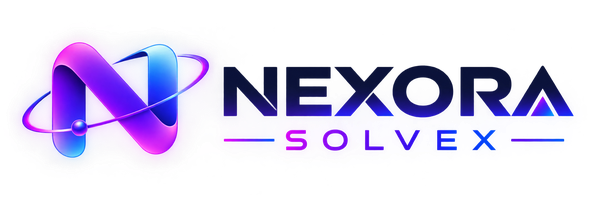

# Nexora Solvex

 

 
**We don't just build websites — we build complete digital systems.**

Nexora is a modern AI-focused startup based in Karachi, Pakistan, dedicated to transforming local businesses through scalable digital infrastructures, intelligent chatbot systems, and AI-assisted automation workflows.

We combine frontend engineering, backend development, AI integrations, dashboard systems, and reusable chatbot components into one practical and scalable ecosystem — designed for businesses that need real solutions, not templates.

Rather than following unnecessary complexity, we prioritize practical implementation, modular architectures, rapid execution, and continuous AI-driven innovation.

Our mission is simple — modernize local businesses, simplify AI adoption, and build intelligent digital systems that actually work.

*Karachi, Pakistan 🇵🇰 · Est. 2026*

 

## 📬 Get In Touch

---

## ⚡ What We Do

<table>
<tr>
<td width="50%">

### 🌐 Website Development
Modern responsive websites designed for professional digital presence and scalable user experiences. Built with performance, accessibility, and visual excellence in mind.

</td>
<td width="50%">

### 🤖 AI Chatbot Integration
Intelligent conversational systems integrated into websites and platforms. Powered by RAG architecture, semantic retrieval, and contextual AI workflows.

</td>
</tr>
<tr>
<td width="50%">

### 📊 Dashboard Systems
Custom administrative dashboards for operational monitoring, analytics, management systems, and workflow handling.

</td>
<td width="50%">

### ⚙️ Automation Workflows
Practical automation systems that reduce repetitive business workflows and improve operational efficiency through intelligent pipelines.

</td>
</tr>
<tr>
<td width="50%">

### 🧠 Semantic AI Systems
Structured AI knowledge systems for improved contextual understanding, semantic search, and business-specific AI grounding.

</td>
<td width="50%">

### 🧩 Reusable UI Systems
Modular chatbot UI components and frontend ecosystems designed for rapid integration and scalable deployment.

</td>
</tr>
</table>

---

## 📦 Live Projects

| Project | Description | Stack | Status |
|---------|-------------|-------|--------|
| [🍔 Hot N Tasty Roll](https://hot-n-tasty-roll.vercel.app/) | Restaurant website with conversational AI chatbot integration | HTML · CSS · JS · Node.js · Firebase · Supabase | ✅ Live |
| [🛍️ Aetheric E-Commerce](https://aetheric-neon.vercel.app/) | Full e-commerce infrastructure with auth & product management | HTML · CSS · JS · Node.js · Firebase · Supabase | ✅ Live |
| [🖥️ Aetheric Admin Dashboard](https://aetheric-admin-panel.vercel.app/) | Scalable admin dashboard with analytics & workflow management | HTML · CSS · JS · Dashboard Systems | ✅ Live |
| [🏨 Hotel Booking Platform](https://hotel-booking-app-amber-omega.vercel.app/) | Modern hotel discovery & booking interface | HTML · CSS · JS · Node.js · MongoDB · Clerk | ✅ Live |

---

## 📝 Client Feedback Portal

A client-facing form where Nexora clients share their project details and honest feedback once a project is delivered. Every response is stored securely and privately, so the team has a clean record of each project and what the client thought of it.

**What the form collects**
- **Client information:** name, email, company, project name, website, and an optional profile picture
- **Project & deployment details:** service plan (Basic / Pro / Enterprise), service category, deployment platform and live URL, project cost, delivery date, and project status
- **Experience ratings:** 1–5 stars for overall experience, design quality, performance, communication & support, and delivery & project handling, plus written feedback and suggestions
- **Confirmation:** a required accuracy declaration, an optional signature image, and optional consent to use the feedback for portfolio or marketing purposes

**What it does for the client**
- Animated welcome screen, a mobile-friendly layout, and inline validation with clear error messages
- A "Review Details" step before submitting
- A thank-you page with a server-generated **Reference ID** and a printable / Save-as-PDF summary

**How it works behind the scenes**
- The browser sends the form to a serverless API route (`/api/submit`) on Vercel, so no database keys are ever exposed to visitors
- The server validates every field, checks that uploaded files are real images, and saves the response to a **Supabase** (PostgreSQL) table with a server-generated timestamp and Reference ID
- Profile and signature images go to a **private Supabase Storage** bucket, and the database blocks all direct public access
- A hidden honeypot field and same-site request checks help filter out spam bots

| Project | Description | Stack | Status |
|---------|-------------|-------|--------|
| Client Feedback Portal | Client feedback & project record form with secure server-side storage | HTML · CSS · JS · Vercel Serverless · Supabase | ✅ Live |

---

## 💰 Pricing

| Plan | Price Range | Best For |
|------|------------|---------|
| 🥉 **Basic** | PKR 11,000 – 15,000 | Simple websites & landing pages |
| 🥈 **Pro** | PKR 17,000 – 24,000 | Full websites with backend & chatbot |
| 🥇 **Enterprise** | PKR 30,000 – 60,000+ | Complete digital systems & AI integrations |

> 💬 Final pricing is determined after project analysis and requirement evaluation. [Contact us](https://nexora.vercel.app) for a custom quote.

---
---

 

© 2026 Nexora Technologies · Karachi, Pakistan 🇵🇰

Building Practical AI-Powered Digital Systems Through Scalable Engineering & Modern Automation

